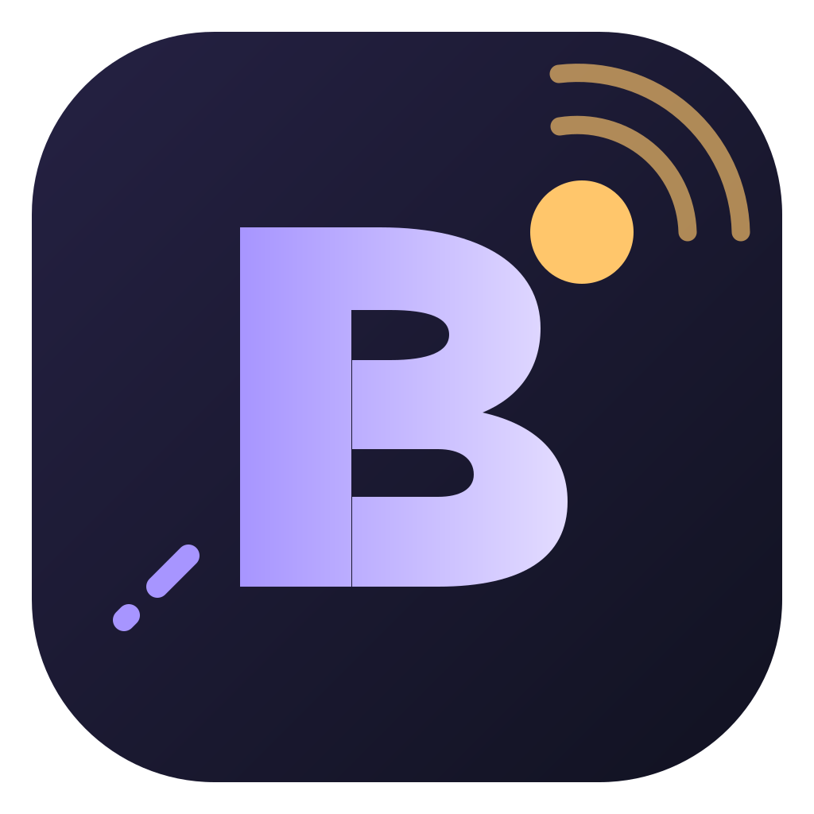

<p align="center"></p>
<h1 align="center">BeaconHop</h1>
<p align="center">Follow the hint. Hop to your work.</p>

BeaconHop is a window navigator for macOS and Windows, adapted from [Screen Buoy](https://github.com/alvinfunborn/screen-buoy). It brings open windows into view with stable letter hints, previews and title/application search.

## Interaction

- **Alt + Tab**: hold Alt to see windows. Tab / Shift + Tab cycle through recent windows. Release Alt to switch.
- **Type a complete hint while holding**: immediately activate that exact window. Hints follow native window identity and stay stable through sorting, filtering and BeaconHop restarts. Closed/recreated windows receive a new allocation.
- **Backslash (`\`)**: enter persistent search; you can release Alt.
- **Cmd + ` on macOS / Win + ` on Windows**: open search directly. Both shortcut editors include recording, manual entry, restore-default actions and same-shortcut feedback. Win + backslash is also supported.
- Search accepts Chinese text, full pinyin, initials, common polyphonic readings and mixed Chinese/Latin terms; Latin accents and full-width letters are normalized. For example, `weixin` / `wx` match 微信, and `chongqing` matches 重庆. Chinese IME composition confirms text before Enter can switch windows.
- All four arrow keys navigate by the visible card positions in both hold and search modes. Tab / Shift + Tab retain recent-window order. Escape cancels. Click a card to switch. Minimized windows are restored.

Both shortcuts are configurable. Desktop and display scopes are independent. Cross-desktop navigation follows a window to its existing desktop; it never moves the window.

## Status and systems

The overview sizes itself to the window inventory, fits every matching window without scrolling, preserves preview aspect ratios, and keeps recent windows first even when filtering. A lightly translucent panel uses native macOS vibrancy / Windows Acrylic behind the content. Centered amber hint badges stay opaque and visible on bright and dark thumbnails. Search keeps the current panel size to avoid movement while typing.

macOS captures previews in bounded parallel batches using one shareable-window query, decodes them before publishing a batch, and reuses an in-memory cache. It warms the initial inventory and refreshes the foreground window after focus changes. Settings includes a persistent restart button; save or discard edits before restarting.

Version 0.1.0 has local macOS app/DMG and Windows EXE/NSIS builds. macOS native validation includes 100 repeated round trips, two displays, multiple Spaces, same-title windows, closed targets and WeType Chinese input; Windows runtime acceptance is pending an accessible test machine. These are development distributions: macOS is ad-hoc signed and not notarized; Windows is unsigned. See [validation](docs/validation.md) for the evidence and remaining checks.

- macOS 14+ (Apple Silicon built locally; Intel remains unverified). Accessibility enables enumeration/focus and normally the keyboard hook; Input Monitoring is a troubleshooting option when the hook remains unavailable. Screen Recording enables previews.
- Windows 11 24H2, build 26100.2605+, is the initial cross-desktop target of the pinned `winvd` adapter. Other Windows versions must be verified before expanding support. Public desktop membership and ordinary window switching are separate from the version-sensitive desktop switching API.
- Windows DWM renders live previews, with title/application placeholders for unavailable or protected windows. macOS uses ScreenCaptureKit.
- System security screens, other users' sessions, and protected/elevated windows that deny focus are outside guaranteed control.

On macOS, missing Accessibility opens the permission setup in the foreground at startup, including background launches. Other settings pages keep a visible access banner. Shortcut configuration can still be entered manually and saved before granting access.

Window metadata, settings and previews are processed locally. Stable hint assignments are saved locally in `hints.json`, keyed by native window identity; closed-window mappings are pruned. Preview pixels are cached only in memory. No analytics, network search, or screenshot upload is included.

## Development

Prerequisites: Node.js 20+, stable Rust, and the [Tauri platform prerequisites](https://v2.tauri.app/start/prerequisites/). macOS additionally requires full Xcode with the Swift compiler and a macOS 14+ SDK. Windows requires Visual Studio C++ build tools and WebView2.

```sh
npm ci
npm run tauri:dev
```

```sh
npm run build
npm test
npx playwright install chromium
npm run test:ui
npm run check:version
npm run tauri -- build
```

For UI-only preview, run `npm run dev` and open `http://127.0.0.1:1437/?preview=1`; the switcher is at `/?preview=1&view=switcher`. Preview mode exists only in the development server and uses labeled fixtures. It does not control real windows.

The project keeps its own application identity (`com.beaconhop.app`) and configuration, separate from Screen Buoy. Set `BEACONHOP_DATA_DIR` to an isolated directory for native tests. Settings can be inspected in the app's System & access → Diagnostics section.

The [branding guide](docs/branding.md) describes the window-stack logo and `npm run icons` asset generation.

## Architecture

- `src-tauri/src/engine.rs`: platform-independent selection, stable hints, MRU, scopes, key release ownership, and search.
- `src-tauri/src/input/`: dedicated native keyboard hook threads. They enqueue actions, without enumeration or screenshot work.
- `src-tauri/src/platform/`: OS adapters and exact foreground validation.
- `src-tauri/native/BeaconBridge.swift`: macOS Accessibility, Space membership, ScreenCaptureKit, and panel bridge.
- `src-tauri/src/runtime.rs`: asynchronous inventory, presentation, activation, settings, and bounded preview cache.
- `src/`: shared settings and switcher UI, English / 简体中文, dark / light themes.

The product abstraction is **work navigation**. Browser tabs, saved work contexts, remote sessions, gaze input and cross-device navigation are future extensions, not implemented features of this window release.

## License and attribution

MIT. Original Screen Buoy copyright is preserved in [LICENSE](LICENSE). This fork began at Screen Buoy commit `045a5f0`; upstream remains read-only, with pushes disabled. The original working tree was not modified. BeaconHop branding, interaction engine, window adapters and interface are maintained independently.
